# Visual Settings Editor

A visual redesign of the Morphe settings for YouTube: every setting next to a live preview of what it changes.

  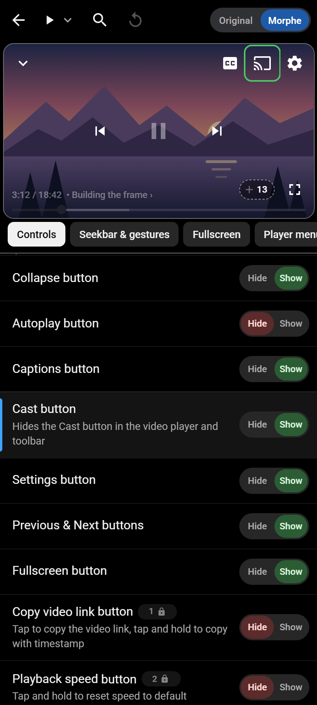

## ❓ Why

Morphe Patches for YouTube keep growing, and there are now hundreds of settings. This project
started from my own frustration with three things:

1. finding a setting,
2. understanding what it does,
3. seeing what it changes.

It got worse when the new glass bar arrived. Getting the bar to look the way I wanted meant a loop:
change a setting → restart → look → dig back through several screens to the setting → tweak →
repeat, then the same again for the next setting. The subreddit is full of the same struggle:
people asking how to change something, sometimes pointing at a piece of the UI and asking which
setting targets it.

No more. This is **Visual Settings Editor**, a visual redesign of the Morphe Patches settings.

## ✨ Highlights

### See the change as you make it

Every setting sits under a live preview of the part of YouTube it changes. Flip it and the preview
animates the change, so you never have to restart YouTube just to look.

  

### Different kinds of change, animated their own way

- **Hide and show:** the part folds out of the UI and back.
- **Point at hidden parts:** tap a setting whose part is hidden, and the part pulses in place with a
  red outline, without changing the setting.
- **Before and after:** settings that change behaviour rather than looks get an Off / On comparison.
- **Gesture demos:** gestures play out with a finger, such as dragging the seekbar for its thumbnails.

| Hide and show | Point at hidden parts | Before and after | Gesture demo |
| :---: | :---: | :---: | :---: |
| 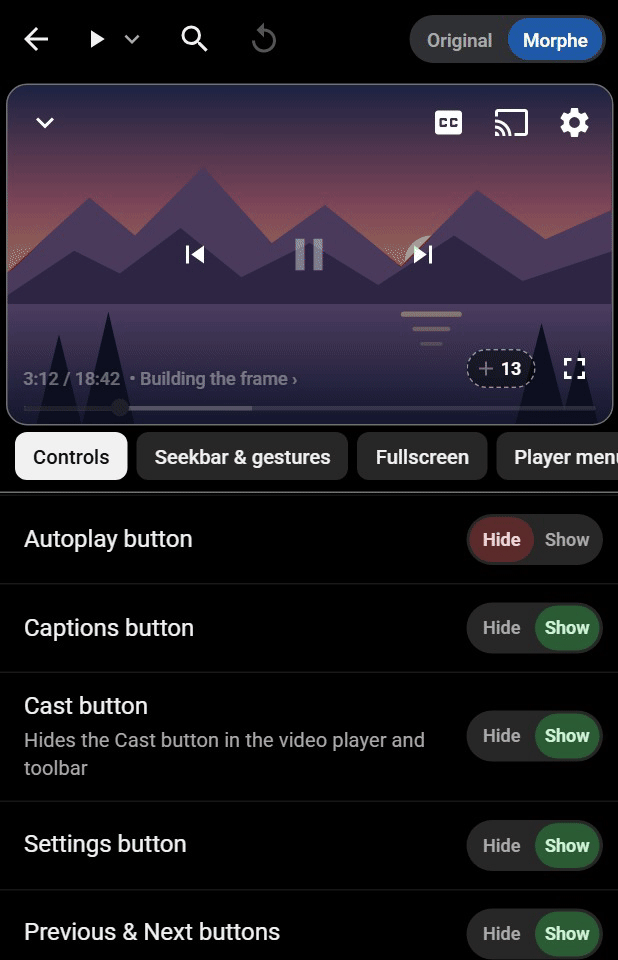 | 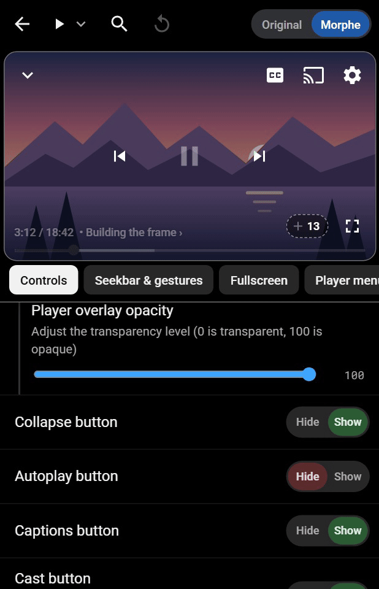 | 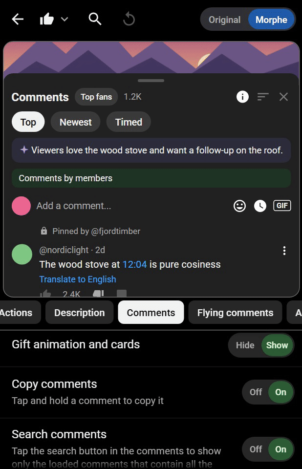 | 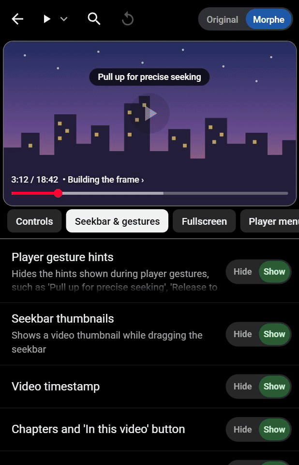 |

### Live previews of the whole app

Player, SponsorBlock segments, flying comments, watch page, comments, home feed, Shorts, miniplayer
and the glass navigation bar each have a preview of their own.

  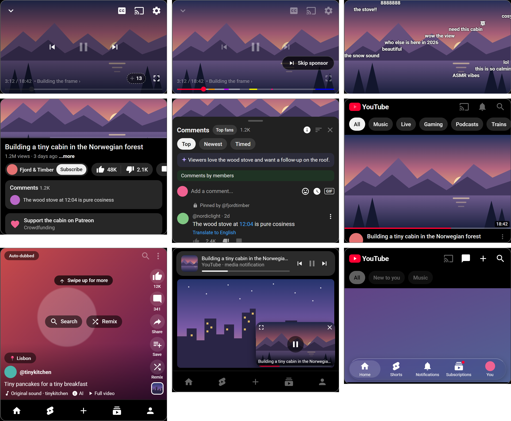

### Your YouTube against stock YouTube

The **Original / Morphe** switch at the top shows stock YouTube next to the result of your settings.

  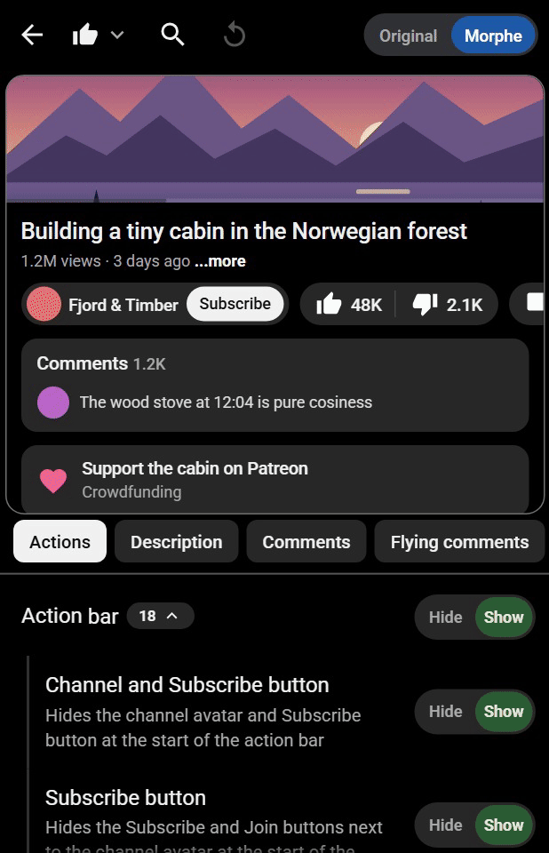
  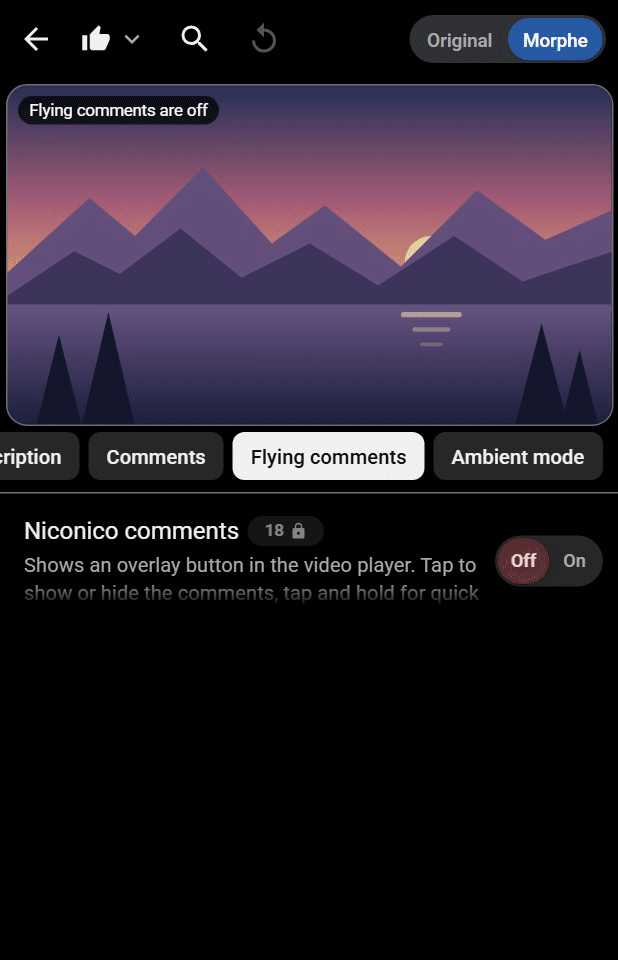

### Choose your design

Pick the UI design (**Original**, **Morphe** or **Glass**) and the list design (**Morphe** Shown / Hidden
pills, **Switches**, or **Clean** Hide / Show toggles).

  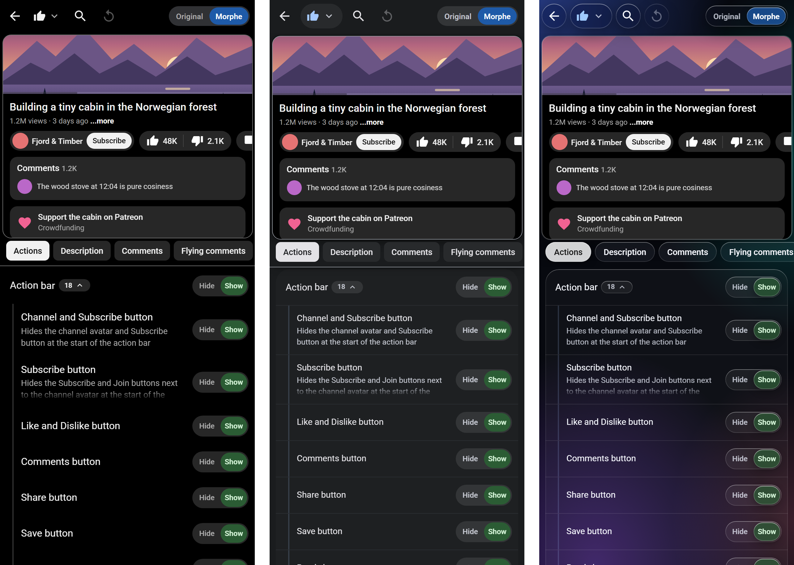

  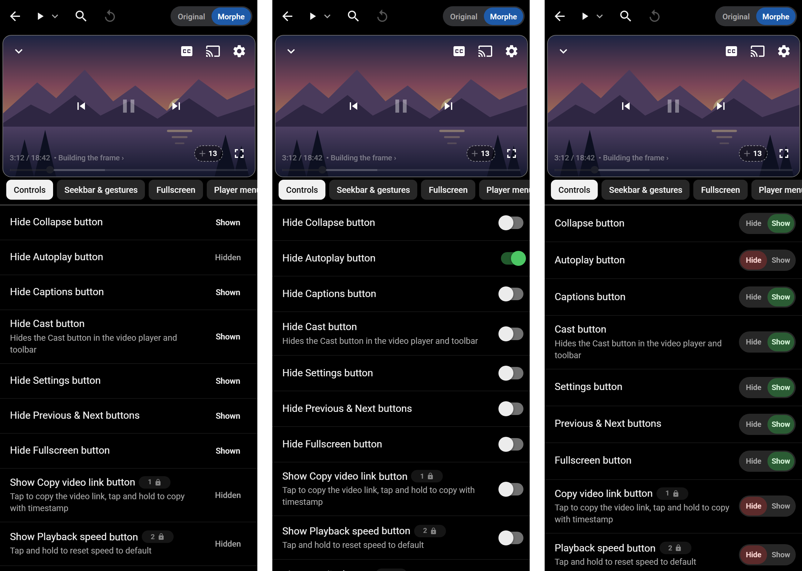

| UI design | List design |
| :---: | :---: |
|  | 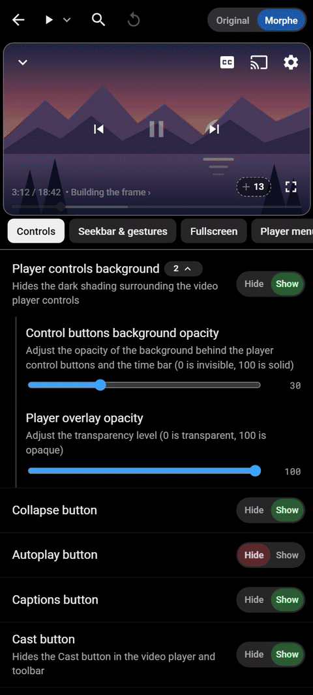 |

### Settings organised your way

Browse all screens as one list, or group them into tabs, so related settings sit together.

  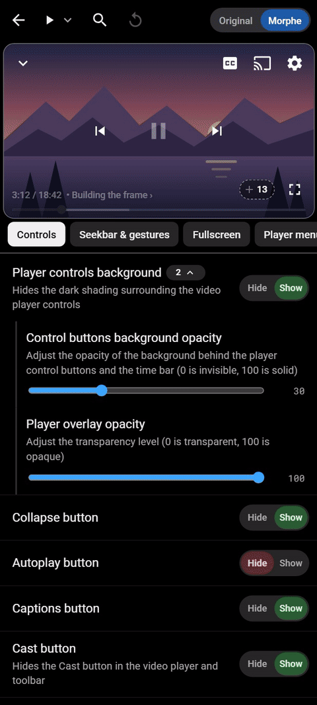

## 📲 How to use it

1. In Morphe Manager, add this repository as a patch source with the button above, or by hand:
   `https://github.com/desumax/visual-settings-editor`.
2. Turn on **Expert mode** and select **both** bundles when patching YouTube: Morphe Patches (with
   at least one patch that adds Morphe settings) and Visual Settings Editor.
3. Open Morphe settings in the patched YouTube. The editor opens first; the regular list is one tap
   back, and the **Visual settings editor** switch above About turns it off.

The editor supports exactly the YouTube versions the official Morphe Patches support.

> [!NOTE]
> These are test releases (0.1.x). Please report anything odd in
> [Issues](https://github.com/desumax/visual-settings-editor/issues), with a screenshot if you can.

## 🧠 How it works

The editor is a front end for the settings you already have, not a copy of them:

- **The list is read from your installed build.** Titles, summaries, choices, order and screens come
  from the same `morphe_prefs.xml` the regular Morphe screen uses, so new, renamed or removed
  settings show up correctly without an editor update.
- **Values go through Morphe's own `Setting` API**, with Morphe's own confirmations, restart
  prompts, import and export.
- **The editor adds only preview hints**: which preview a setting belongs to and how its change
  animates. A setting without a hint is still listed as a plain row.
- **Nothing else is touched.** It is one optional patch that adds one call to the Morphe settings
  screen. If it can't find what it needs on a YouTube build, it leaves the app unchanged.

More detail: [docs/ARCHITECTURE.md](docs/ARCHITECTURE.md) and [docs/COMPATIBILITY.md](docs/COMPATIBILITY.md).

## 🩹 Patches list

<!-- PATCHES_START -->

<!-- Do not modify this section by hand. The patch list is generated when release.yml creates a new release. -->

| App | Patch | Description |
| --- | --- | --- |
| YouTube | Visual settings editor | Adds an optional visual editor at the top of Morphe settings. Needs the Morphe Patches bundle in the same patching run. |

<!-- PATCHES_END -->

## 🛠️ Development

| Folder | What it holds |
| --- | --- |
| `patches/` | The patch (`VisualSettingsEditorPatch.kt`) and the YouTube compatibility copied from Morphe Patches. |
| `extensions/visualeditor/` | The extension: the WebView host, the bridge to the real settings, and the live settings reader. |
| `editor/web/` | The editor itself: one web page that is both the desktop preview and what runs inside YouTube. |
| `editor/app/` | The in-app layer and the packer that turns the page into `WebAssets.java` at build time. |
| `editor/tools/` | Regression checks, the animation check and the catalogue and drift tools. |
| `docs/media/`, `scripts/demos/` | The README images and GIFs, and the scripts that make them. |

- **Preview the editor in a browser:** open `editor/web/index.html`.
- **Build the bundle:** `./gradlew :patches:buildAndroid` (JDK 17+, the Android SDK, and a GitHub
  token with `read:packages` as described in the
  [Morphe setup guide](https://github.com/MorpheApp/morphe-patcher/blob/main/docs/2_1_setup.md#-prepare-the-environment)).
  The result is `patches/build/libs/patches-<version>.mpp`.
- **Checks:** `node editor/tools/regress/regress.js` and `node editor/tools/animcheck/animcheck.js`
  (Playwright), also run by the **Editor checks** workflow on every push that touches `editor/`.
- **After a Morphe Patches release:** `python scripts/sync_compatibility.py` updates the supported
  YouTube versions, and `editor/tools/check_drift.py` lists preview hints whose setting was renamed
  or removed.
- **Releases:** commit with `feat:`, `fix:` or `perf:` messages, then run the **Release** workflow
  (Actions → Release → Run workflow). It picks the next version, builds the bundle, updates
  `CHANGELOG.md` and the Manager feed (`patches-bundle.json`), tags and publishes the release.

## 🙏 Credits

- **[Morphe](https://github.com/MorpheApp)**: [Morphe Patches](https://github.com/MorpheApp/morphe-patches),
  whose settings this editor shows and whose code it builds on;
  [Morphe Patcher](https://github.com/MorpheApp/morphe-patcher),
  [Morphe Patches Library](https://github.com/MorpheApp/morphe-patches-library),
  [Morphe Manager](https://github.com/MorpheApp/morphe-manager) and the
  [patches template](https://github.com/MorpheApp/morphe-patches-template) this repository is made from.
- **[ReVanced](https://github.com/ReVanced)**, whose prior work Morphe Patches are based on.
- The projects whose features the previews show, all integrated by Morphe Patches:
  [SponsorBlock](https://sponsor.ajay.app),
  [Return YouTube Dislike](https://returnyoutubedislike.com) and
  [DeArrow](https://dearrow.ajay.app).
- Icon sets of the player icon styles, taken from Morphe Patches:
  [Fluent UI System Icons](https://github.com/microsoft/fluentui-system-icons) (MIT),
  [Phosphor Icons](https://github.com/phosphor-icons/core) (MIT),
  [Ionicons](https://github.com/ionic-team/ionicons) (MIT) and
  [Material Symbols](https://github.com/google/material-design-icons) (Apache 2.0).
- [Roboto](https://fonts.google.com/specimen/Roboto) (OFL) in the browser preview, and
  [Playwright](https://playwright.dev) (Apache 2.0) for the checks and the demo captures.

Visual Settings Editor is an independent project. It is not affiliated with or endorsed by Morphe,
ReVanced or Google. YouTube is a trademark of Google LLC.

## 📜 License

[GNU General Public License v3.0](LICENSE), with the additional GPL section 7 terms in [NOTICE](NOTICE).
